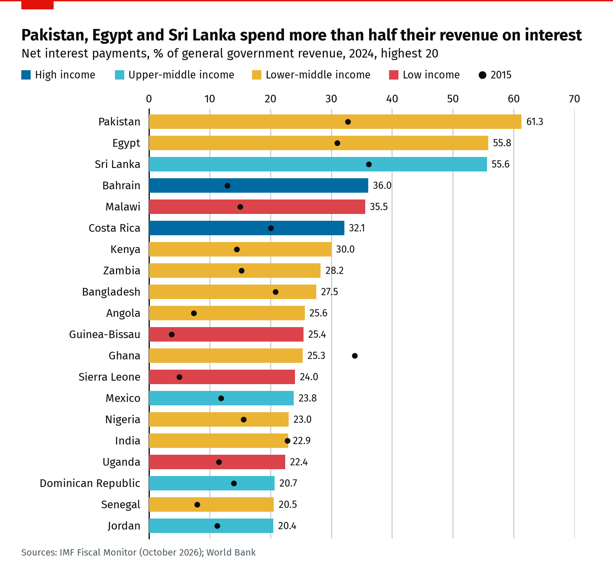
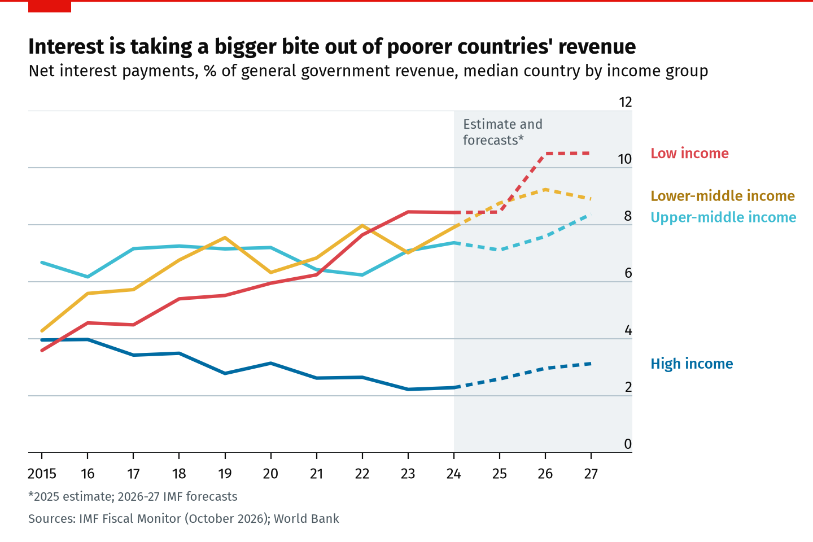
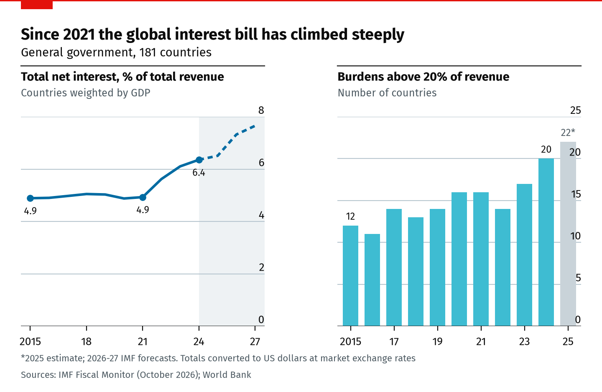
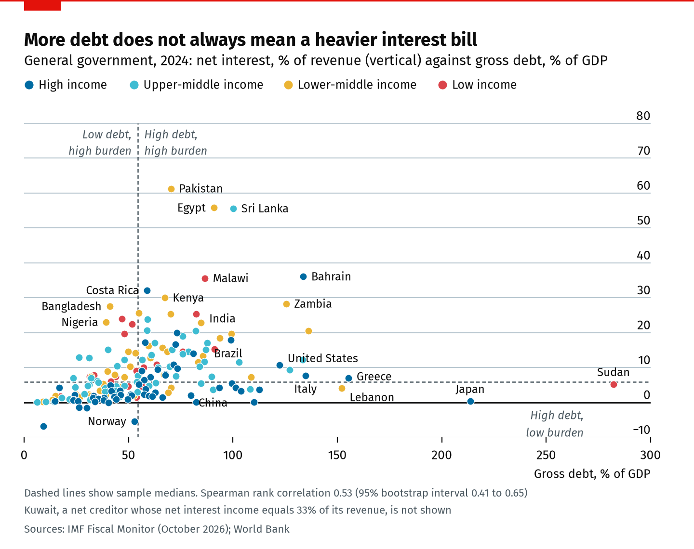
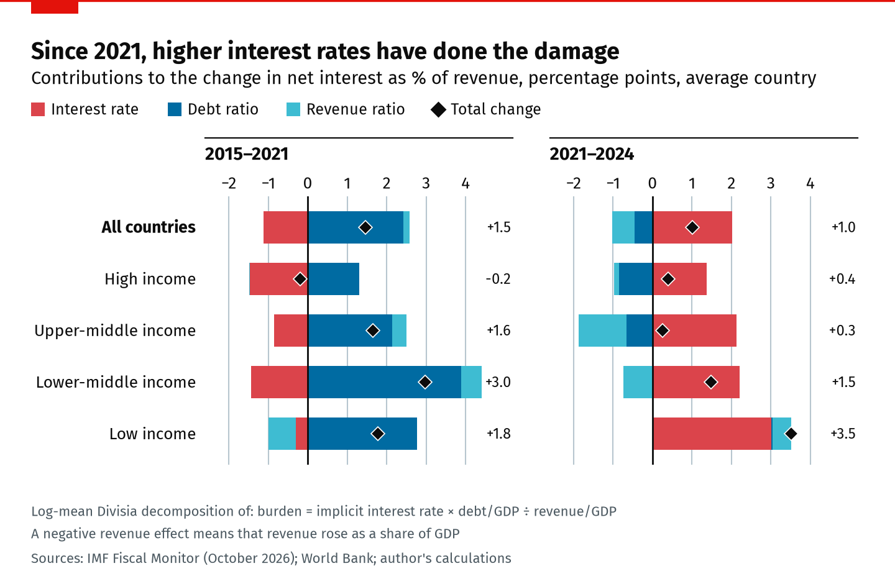
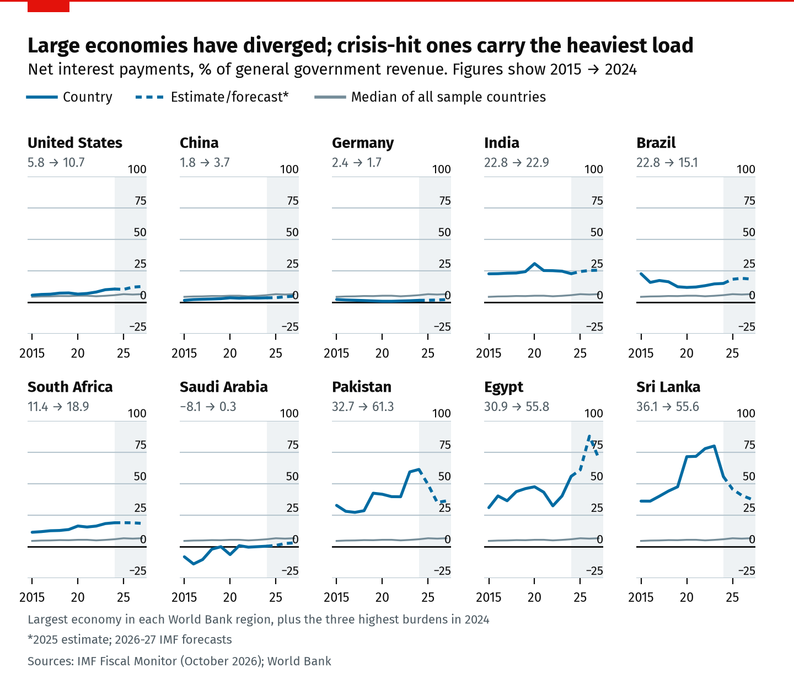
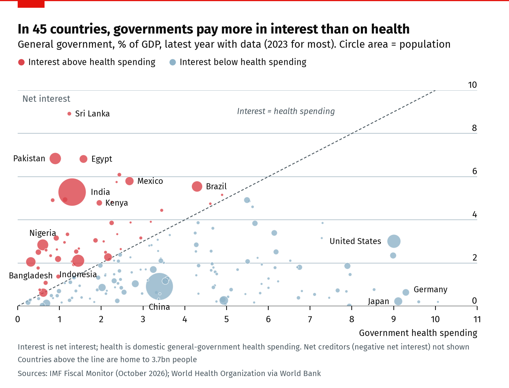
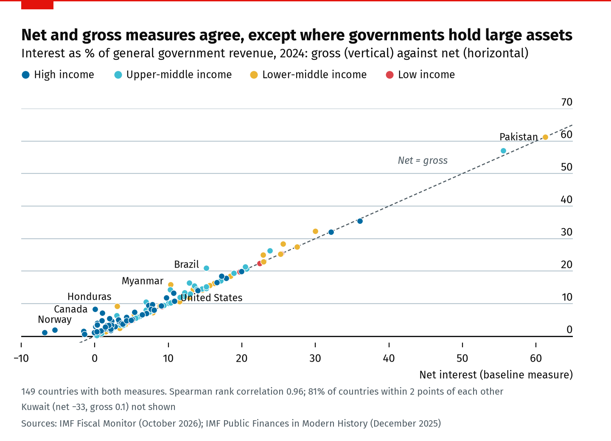

<!-- Generated from templates/economic_analysis.md by src/build_report.py. Edit the template, not this file. -->

# The cost of public debt

How much government revenue goes to interest, why it differs so much between countries, and what changed after 2021. A cross-country analysis of 181 economies, 2015–2024

Sidali Saidj · October 2026 · Data: IMF Fiscal Monitor (October 2026), World Bank

## Executive summary

**Question.** How much government revenue is absorbed by interest payments, how has that share changed between 2015 and 2024, and is the debt-to-GDP ratio a reliable guide to which economies bear the heaviest burden?

**Approach.** Net interest as a share of general-government revenue, built from the IMF's October 2026 Fiscal Monitor for a balanced panel of 181 economies. The burden is split into three parts (the implicit interest rate, the debt ratio and the revenue ratio) to see which one drove each change. Two gross-interest series from the IMF and the World Bank serve as cross-checks.

**Main findings**

1. **Interest takes a growing share of revenue, but not everywhere.** The median government spent 5.8% of its revenue on net interest in 2024, against 4.5% in 2015; 113 of 181 economies saw a rise. For all 181 combined, net interest went from 4.9% of total revenue in 2021 to 6.4% in 2024, about $2.2trn.
2. **Poorer countries carry the heavier and faster-growing load.** The median burden rose from 3.6% to 8.4% in low-income economies and from 4.3% to 7.9% in lower-middle-income ones, while in the typical high-income economy it fell from 4.0% to 2.3% (on a gross basis it was roughly flat, at 4.8% and 4.6%). The number of governments spending more than a fifth of their revenue on interest rose from 12 in 2015 to 20 in 2024; they govern 2.7bn people.
3. **Debt-to-GDP is only a partial guide.** Debt and burden are clearly related (rank correlation 0.53), but debt alone accounts for about a quarter of the cross-country variation in burdens. Adding revenue nearly doubles the explained share. In all, 52 economies sit in the "wrong" quadrant: above-median debt with a below-median burden (mostly rich countries), or the reverse (mostly poorer ones).
4. **Thin revenue is the main reason poor countries' burdens are high.** Low-income governments collect 16.8% of GDP in revenue, against 36.7% in high-income ones. Middle-income governments also pay roughly twice the implicit interest rate of high-income ones at the same debt ratio.
5. **Since 2021, higher interest rates did the damage.** For the average country the burden rose by 1.0 points between 2021 and 2024. Higher implicit rates added 2.0 points; falling debt ratios and rising revenue took off 1.0. Between 2015 and 2021 the driver was debt accumulation, while falling rates held the burden down.
6. **Interest now competes with health spending.** In 45 countries, home to 3.7bn people, governments pay more in net interest than they spend on health.

**Implications.** Judging fiscal risk by debt-to-GDP alone misses where the pressure is: a government with modest debt but a narrow tax base can be more constrained than one with twice the debt. For the most burdened economies, raising revenue does more for affordability than any feasible cut in the debt ratio. Debt-management choices that lengthen maturities and reduce exposure to foreign-currency and short-term borrowing also slow how fast rate shocks feed into budgets. These are implications of the accounting and the cross-country patterns, not tested policy effects.

## 1. The problem

Interest is the one item in a budget that cannot be cut without a political or legal event. A finance ministry can trim wages, delay investment or reform transfers, but coupons are owed. The share of revenue that goes to interest therefore measures how much of a government's income is spoken for before it decides anything else. Rating agencies use it in exactly this way: Moody's, for example, scores "debt affordability" by interest payments relative to revenue alongside the debt-to-GDP ratio (Moody's, 2019).

The ratio had good reason to rise after 2021. Debt stocks jumped during the pandemic, and from 2022 central banks raised policy rates at the fastest pace in four decades. Because governments refinance gradually, higher market rates reach the interest bill with a lag. The IMF has warned that global public debt is set to keep rising and that risks are tilted towards worse outcomes (IMF, 2024). UNCTAD (2024) estimated that 3.3bn people live in countries that spend more on interest than on health or education.

This report asks three things: how large the burden is, how and why it changed between 2015 and 2024, and whether the familiar debt-to-GDP ratio identifies the governments under most pressure.

## 2. Economic framework

### 2.1 An identity with three moving parts

The burden can be written exactly as the product of three ratios (Escolano, 2010, sets out the related debt-dynamics algebra):

interest / revenue = (interest / debt) × (debt / GDP) ÷ (revenue / GDP)

The first term is the *implicit interest rate*: the average rate paid on the whole stock of debt. It moves more slowly than market yields because only maturing and new debt is repriced. The second is the debt ratio. The third is the government's capacity to raise revenue. The identity explains why the debt ratio alone can mislead: two countries with the same debt can face very different burdens if one borrows at 2% and collects 40% of GDP in revenue while the other borrows at 8% and collects 12%.

### 2.2 Mechanisms and competing explanations

Each term has its own economics:

- **Borrowing costs.** Rates depend on the global rate cycle, on country risk premia and on the structure of debt. Economies with a history of default or high inflation face higher premia and become stressed at lower debt levels ("debt intolerance"; Reinhart, Rogoff and Savastano, 2003). Governments that cannot borrow abroad in their own currency pay for exchange-rate risk ("original sin"; Eichengreen and Hausmann, 1999). Concessional loans from development lenders push the other way for the poorest countries.
- **Debt.** Deficits add to the stock. Inflation and growth reduce the *ratio* by raising nominal GDP, which is why high inflation in 2022–23 lowered many debt ratios even as rates rose.
- **Revenue.** A narrow tax base, a large informal sector or dependence on commodity revenue means a given interest bill absorbs a larger share of income.

A rise in the burden can also have a misleading counterpart: a fall. A government that defaults stops paying interest, so its burden drops without any improvement in its finances. Lebanon, Ghana and Sri Lanka all show this pattern in the data.

### 2.3 Hypotheses

| | Hypothesis, stated before the main analysis |
|---|---|
| H1 | The typical country's burden was higher in 2024 than in 2015, with most of the increase after 2021. |
| H2 | Debt-to-GDP is positively but only weakly associated with the burden across countries. |
| H3 | At comparable debt ratios, lower-income economies carry heavier burdens because they pay higher rates and collect less revenue. |
| H4 | Between 2021 and 2024 the rise came mainly from higher implicit rates, partly offset by falling debt ratios. |

## 3. Related research

The debate about how to judge public debt has shifted from stocks towards flows. Blanchard (2019) showed that when the interest rate is below the growth rate, debt can be rolled over at low fiscal cost, so high debt ratios need not imply high burdens. Furman and Summers (2020) argued that real interest payments relative to GDP are a better guide to fiscal space than the debt stock. This report applies the same logic to revenue rather than GDP, because revenue is what pays the bill. Their argument assumed persistently low rates; the period studied here includes the end of that era.

A second strand explains why emerging and developing economies face stress at lower debt levels: debt intolerance linked to default and inflation histories (Reinhart, Rogoff and Savastano, 2003) and currency mismatches (Eichengreen and Hausmann, 1999). Kose et al. (2021) document how the post-2010 wave of debt in developing economies differed from earlier ones in its speed and breadth. On the measurement side, the IMF's Public Finances in Modern History database (Mauro et al., 2015) provides long series of gross interest, used here as a cross-check.

UNCTAD (2024) and the IMF (2024) have documented the rising cost of debt with aggregate statistics. This report adds three things: a transparent, reproducible cross-country measure built from one consistent source; a formal test of how much the debt ratio explains; and an exact decomposition of changes in the burden into rate, debt and revenue effects before and after the 2022 tightening. The full review is in [research/literature_review.md](../research/literature_review.md).

## 4. Data and method

**Sources.** General-government revenue, gross debt, primary balance and overall balance come from the IMF Fiscal Monitor (October 2026), via the IMF DataMapper API. GDP in US dollars is from the October 2026 World Economic Outlook. Gross interest is from the IMF Public Finances in Modern History database (December 2025). The World Bank supplies the central-government interest series (`GC.XPN.INTP.RV.ZS`), health and education spending, population, regions and income groups. All data were retrieved on 21 October 2026 and are stored in the repository as a frozen snapshot.

**Measure.** Net interest equals the primary balance minus the overall balance; the burden is net interest divided by revenue. Net interest is lower than gross interest when governments earn interest on financial assets. The two agree closely for most economies (rank correlation 0.96 across 149 countries; 81% within two points) but diverge for a few asset-rich governments, such as Canada (net 0.0%, gross 8.3%) and Japan (net 0.3%, gross 4.0%). The net measure is used because it covers far more countries and comes from the same vintage as the debt and revenue data.

**Sample.** Every economy with all four fiscal series in each year from 2015 to 2024: 181 economies (61 high-income, 55 upper-middle, 45 lower-middle and 20 low-income). Of the economies with some fiscal data, 12 fail this rule, mostly because debt is not reported (for example Venezuela) or interest is not separately identified (Brunei, Libya, Macao). The full list and other data checks are in [audit/validation_report.md](../audit/validation_report.md). Values for 2025 are partly estimates and 2026–27 are IMF forecasts; they are shown as context only.

**Methods.** The typical country is described by medians, because burdens are strongly skewed. The total for all countries is a GDP-weighted aggregate (total net interest over total revenue, in US dollars). The relationship between debt and burden is measured by a Spearman rank correlation with a bootstrap confidence interval, and by log-log regressions with heteroskedasticity-robust (HC3) standard errors. Changes in the burden are split exactly into rate, debt and revenue effects with a log-mean Divisia index (Ang, 2004). Case studies were chosen by a rule fixed in advance: the largest economy in each World Bank region plus the three highest burdens in 2024. Details are in [research/methodology.md](../research/methodology.md).

## 5. Results

### 5.1 How much revenue goes to interest?

In 2024 the median government spent 5.8% of its revenue on net interest. The distribution has a long right tail: 20 economies spent more than 20%, and three spent more than half: Pakistan (61.3%), Egypt (55.8%) and Sri Lanka (55.6%) (Figure 1). Of the top 20, 14 are low- or lower-middle-income economies. Two high-income exceptions are instructive. Bahrain is a high-income economy whose debt has risen to 134% of GDP while its revenue, mostly from oil, is only 18% of GDP. Costa Rica combines moderate debt with an implicit rate of 8.1% and revenue of 15% of GDP.

Figure 1

The burden differs systematically by income. In 2024 the median low-income government spent 8.4% of revenue on interest, 3.7 times the 2.3% of the median high-income government, although their median debt ratios were similar (53% and 57% of GDP).

### 5.2 How has the burden changed?

For the typical country the burden rose steadily, from 4.5% in 2015 to 5.4% in 2021 and 5.8% in 2024. Behind that median, income groups diverged (Figure 2). The median low-income burden more than doubled, from 3.6% to 8.4%, and rose in almost every year. The lower-middle-income median went from 4.3% to 7.9%. The high-income median fell, from 4.0% to 2.3%. Its median implicit rate barely moved after 2021 (1.8% in 2021, 1.8% in 2024), which is consistent with long-dated debt locked in at low rates before 2022. Part of the fall is also a feature of the net measure: as rates rose, governments with financial assets earned more interest. On a gross basis the high-income median was roughly flat (4.8% in 2015, 3.3% in 2021, 4.6% in 2024), while the low-income one rose from 3.7% to 9.1%: the gap widened on either measure. IMF forecasts show the low-income median rising further, to 10.5% by 2027.

Figure 2

Weighting by GDP tells a different story about timing (Figure 3). Total net interest across the 181 economies was 4.9% of total revenue in 2015 and still 4.9% in 2021, then rose to 6.4% by 2024. That aggregate is dominated by large economies whose interest bills responded quickly to higher rates: the United States' burden went from 7.2% in 2021 to 10.7% in 2024. In dollars, net interest rose from $1.55trn in 2021 to $2.24trn in 2024 (nominal, at market exchange rates). The number of governments spending more than a fifth of revenue on interest rose from 12 in 2015 to 20 in 2024, and an estimated 22 in 2025.

Figure 3

**Verdict on H1: partly supported.** The burden of the typical country was higher in 2024 than in 2015. But for the median country the rise was spread across the whole period, driven by poorer economies, rather than concentrated after 2021. The concentration after 2021 holds for the GDP-weighted total. The median high-income burden fell on the net measure and was roughly flat on the gross one.

### 5.3 Is debt-to-GDP a reliable guide?

Countries with more debt do tend to spend more of their revenue on interest. The Spearman rank correlation in 2024 is 0.53 (95% bootstrap interval 0.41 to 0.65), and it is positive within each income group, though imprecisely estimated for the 20 low-income economies. But the scatter is wide (Figure 4). Japan has the highest debt ratio among large economies (214% of GDP) and a net burden of 0.3% (4.0% gross). Nigeria's debt is 39% of GDP, yet interest absorbs 23% of revenue, because revenue is only 11% of GDP. Bangladesh is similar (debt 41%, revenue 8.3%, burden 28%).

Figure 4

Of the 181 economies, 26 have above-median debt but below-median burdens, and 26 the reverse. Of the first group, 62% are high-income economies; of the second, 65% are low- or lower-middle-income.

Table 1 makes the point formally. In logs, debt alone explains 25% of the cross-country variation in burdens (model 1). Adding the revenue ratio raises this to 48% (model 2). The coefficients sit close to what the identity implies: a 1% higher debt ratio goes with a burden about 1.0% higher, and a 1% higher revenue ratio with a burden about 1.3% lower. Neither differs significantly from one in magnitude. Model 4 confirms the implication: across countries, implicit rates are unrelated to the debt ratio (coefficient 0.10, interval -0.26 to 0.46), so more indebted governments do not systematically borrow more cheaply or more expensively.

Table 1. What explains cross-country differences in interest burdens, 2024

| | (1) Debt only | (2) Debt and revenue | (3) Adding income group | (4) Implicit rate |
|---|---|---|---|---|
| Dependent variable | log burden | log burden | log burden | log implicit rate |
| log debt/GDP | 1.12 [0.74, 1.50] | 1.01 [0.61, 1.40] | 1.07 [0.71, 1.43] | 0.10 [-0.26, 0.46] |
| log revenue/GDP | | -1.32 [-1.91, -0.73] | -1.28 [-1.85, -0.70] | |
| Income-group dummies | No | No | Yes | Yes |
| R² | 0.25 | 0.48 | 0.54 | 0.12 |
| Countries | 175 | 175 | 175 | 175 |

OLS on 2024 cross-section; 95% confidence intervals from HC3 robust standard errors in brackets. Countries with positive net interest only. Full output, including income-group coefficients: <a href="../outputs/tables/regressions.csv">outputs/tables/regressions.csv</a>.

**Verdict on H2: partly supported.** The association is positive and moderate rather than weak. But debt alone leaves three-quarters of the variation unexplained, and 29% of countries fall on the "wrong" side of the median on one measure or the other.

### 5.4 Why are poorer countries' burdens higher?

The identity points to two channels, and the data show both. Revenue is the larger one. The median low-income government raises 16.8% of GDP and the lower-middle-income one 20.5%, against 36.7% in high-income economies. With similar debt ratios, that gap alone roughly doubles the burden.

Rates are the second channel. Holding the debt ratio constant (Table 1, model 4), upper-middle-income governments pay implicit rates about 2.2 times, and lower-middle-income ones about 1.9 times, those of high-income governments. Both differences are statistically clear. For low-income economies the estimate is 1.4 times but imprecise (the interval includes no difference), probably because much of their debt is concessional. Their implicit rates are rising fastest: the median went from 1.5% in 2015 to 3.4% in 2024, overtaking the high-income median of 1.8%. The data cannot say whether this reflects more borrowing on commercial terms, more expensive domestic debt or higher rates on new loans.

**Verdict on H3: supported, with a qualification.** Lower-income economies carry much heavier burdens at similar debt levels. Weak revenue explains most of the gap; higher rates matter clearly for middle-income economies and, less certainly, for low-income ones.

### 5.5 What drove the change?

Figure 5 splits each country's change in burden into its three components, averaged by income group. The two periods look very different.

Figure 5

Between 2015 and 2021 the burden of the average country rose by 1.5 points. Debt accumulation, much of it during the pandemic, contributed +2.4 points; falling implicit rates contributed -1.1. Between 2021 and 2024 the roles reversed. Higher implicit rates contributed +2.0 points and were the largest of the three contributions in 72% of countries. Falling debt ratios contributed -0.5 points, consistent with inflation raising nominal GDP faster than debt, and rising revenue -0.6. The rate effect was largest for low-income economies (3.0 points), whose revenue ratios also slipped. Upper-middle-income economies offset most of their rate shock with higher revenue and lower debt ratios.

Medians tell the same story with smaller magnitudes (2021–24 median rate effect 1.2 points against a median change of 0.6; see `outputs/tables/decomposition_by_group.csv`).

**Verdict on H4: supported.** The rise after 2021 came from higher rates, with falling debt ratios and rising revenue offsetting about half of it.

### 5.6 Country cases

The ten case studies (Figure 6) show how the same shocks played out differently. In the **United States** the burden almost doubled, from 5.8% to 10.7%, as a high and rising debt ratio (122% of GDP) met higher rates; the IMF expects 12.7% by 2027. **China**'s burden doubled from a low base (1.8% to 3.7%) as general-government debt more than doubled, to 91% of GDP, at an implicit rate of only 1.1%. **Germany**'s fell, from 2.4% to 1.7%. **India**'s stayed high and roughly flat at about 23%, reflecting an implicit rate of 5.8% on debt of 85% of GDP. **Brazil**'s fell from 23% to 15% on the net measure, though its gross burden was 21% in 2024. **South Africa**'s rose from 11% to 19% as debt climbed from 45% to 76% of GDP. **Saudi Arabia** moved from being a net earner of interest to a small net payer as it borrowed.

Figure 6

The three most burdened economies show crisis dynamics. **Pakistan**'s burden reached 61% in 2024, with an implicit rate of 11% and revenue of 13% of GDP. **Egypt**'s reached 56%, and the IMF projects a peak of 88% in 2026. **Sri Lanka**'s peaked at 80% in 2023 and fell to 56% in 2024 as it restructured its debt. Lebanon is the warning against reading a falling burden as good news: its burden dropped from 47% in 2015 to 4% in 2024 because it defaulted in 2020 and stopped servicing much of its debt.

### 5.7 Interest and social spending

Comparing net interest with government health spending, both as shares of GDP in the latest year with data (2023 for most), 45 of 177 countries spend more on interest (Figure 7). They are home to 3.7bn people; the most populous are India (interest 4.9% of GDP in 2024; health 1.3% in 2023), Indonesia, Pakistan, Nigeria and Brazil. For education the count is 26 countries, with 2.8bn people. These figures are of the same order as UNCTAD's (2024) estimate of 3.3bn people, which used different years and definitions.

Figure 7

The comparison is descriptive. It does not show that interest payments crowded out health spending; health budgets in these countries were low before interest costs rose.

## 6. Robustness

The main results hold under the alternatives set out in advance (Table 2). On the gross measure the median burden is higher, as expected, but the change since 2015, the share of high-burden countries and the debt–burden correlation are similar. Results also hold without net-creditor governments, without small states and with 2025 estimates as the end year. Dropping the top and bottom 5% of burdens leaves the rank correlation at 0.52. Figure 8 shows the agreement between net and gross measures country by country.

Table 2. Robustness of headline statistics

| Specification | Countries | Median burden, % | Median change since 2015, points | Share above 20%, % | Debt–burden rank correlation |
|---|---|---|---|---|---|
| Baseline (net, general government) | 181 | 5.8 | 0.9 | 11 | 0.53 |
| Gross interest, general government (IMF FPP) | 149 | 7.4 | 1.2 | 11 | 0.50 |
| Gross interest, central government (World Bank) | 88 | 6.2 | 0.7 | 10 | 0.52 |
| Excluding net-creditor governments | 175 | 6.5 | 1.1 | 11 | 0.50 |
| Excluding small states | 142 | 5.9 | 1.4 | 14 | 0.45 |
| End year 2025 (estimates) | 181 | 6.6 | 1.1 | 12 | 0.52 |

Gross-interest rows cover fewer countries. On exactly the same countries, the baseline median is 7.0% (FPP sample) and 5.4% (World Bank sample), so most of the gap in levels is the net-versus-gross concept, not sample composition.

Figure 8

## 7. Limitations

- **Association, not causation.** The regressions describe cross-country patterns in one year. Debt, revenue and borrowing costs are shaped jointly by institutions, history and shocks the data do not measure.
- **Net versus gross.** Net interest understates the cash cost for governments with large financial assets; gross results are reported alongside.
- **Implicit rate.** Dividing interest by end-year debt gives an average rate that mixes old and new borrowing and is affected by exchange-rate movements on foreign-currency debt. It is not a market yield.
- **Coverage and comparability.** General-government coverage differs across countries (some report only the central or budgetary government), and data for 2025 are partly estimates. A different IMF vintage will revise the numbers.
- **What the ratio leaves out.** Interest-to-revenue says nothing about maturity, currency composition, who holds the debt or whether the government can roll it over, all of which matter for default risk. Principal repayments, often the binding constraint in a liquidity crisis, are excluded.

## 8. Policy implications

The evidence supports four practical conclusions. They follow from the identity and the patterns above; none is a tested estimate of a policy's effect.

1. **Monitor affordability, not just the debt stock.** A debt ceiling or anchor expressed only as a share of GDP would have flagged Japan and missed Nigeria and Bangladesh. Adding interest-to-revenue to fiscal rules and surveillance would point at where pressure is building.
2. **For the most burdened, revenue is the main lever.** Because the burden is inversely proportional to the revenue ratio, raising revenue from 12% to 15% of GDP cuts the burden by a fifth at unchanged debt. Debt reduction on that scale would take years of primary surpluses.
3. **Debt structure determines how fast rate shocks arrive.** Longer maturities and less reliance on short-term and foreign-currency debt slow the pass-through of rate rises. The rise in low-income economies' implicit rates is a reason for lenders and borrowers to watch borrowing terms, not only volumes.
4. **Read falling burdens with care.** A drop after default or restructuring (Lebanon, Ghana, Sri Lanka) reflects unpaid interest, not restored sustainability.

## 9. Conclusion

Interest took a larger share of government revenue in 2024 than in 2015 for most of the 181 economies studied. The typical burden rose from 4.5% to 5.8%, and the aggregate jumped after 2021. The increase was concentrated in poorer economies, while the typical rich economy's burden fell on a net basis and held steady on a gross one. The debt-to-GDP ratio is a useful but incomplete guide: it explains about a quarter of the cross-country differences, and weak revenue explains much of the rest. Since 2021, higher interest rates have been the main force pushing burdens up. With IMF forecasts showing the low-income median still rising, these pressures look set to continue.

Next steps that the data would support: extend the analysis to debt service including principal, separate domestic and external debt, and test whether high burdens precede cuts in public investment using a panel design with an identification strategy.

| | Verdict |
|---|---|
| H1: burden higher in 2024 than 2015, mostly after 2021 | Partly supported: higher, but for the median country the rise was spread over the decade |
| H2: debt weakly associated with burden | Partly supported: moderately associated, yet a poor guide on its own |
| H3: lower-income economies carry heavier burdens at similar debt | Supported: mainly through weaker revenue, also higher rates for middle-income economies |
| H4: rates drove the rise after 2021 | Supported |

## References

Ang, B. W. (2004). Decomposition analysis for policymaking in energy: which is the preferred method? *Energy Policy*, 32(9), 1131–1139.

Blanchard, O. (2019). Public debt and low interest rates. *American Economic Review*, 109(4), 1197–1229.

Eichengreen, B., and Hausmann, R. (1999). Exchange rates and financial fragility. NBER Working Paper 7418.

Escolano, J. (2010). *A Practical Guide to Public Debt Dynamics, Fiscal Sustainability, and Cyclical Adjustment of Budgetary Aggregates*. IMF Technical Notes and Manuals 10/02.

Furman, J., and Summers, L. (2020). A reconsideration of fiscal policy in the era of low interest rates. Discussion draft, Hutchins Center on Fiscal and Monetary Policy and Peterson Institute for International Economics.

IMF (2024). *Fiscal Monitor, October 2024: Putting a Lid on Public Debt*. Washington, DC: International Monetary Fund.

IMF (2026). *Fiscal Monitor database, October 2026*, and *World Economic Outlook database, October 2026*. Retrieved via the IMF DataMapper API, 21 October 2026.

IMF (2025). *Public Finances in Modern History database*, December 2025 update. Retrieved via the IMF DataMapper API, 21 October 2026.

Kose, M. A., Nagle, P., Ohnsorge, F., and Sugawara, N. (2021). *Global Waves of Debt: Causes and Consequences*. Washington, DC: World Bank.

Mauro, P., Romeu, R., Binder, A., and Zaman, A. (2015). A modern history of fiscal prudence and profligacy. *Journal of Monetary Economics*, 76, 55–70.

Moody's Investors Service (2019). *Sovereign Ratings Methodology*, November 2019. Superseded in November 2022 by a version that keeps the same factors and sub-factors.

Reinhart, C. M., Rogoff, K. S., and Savastano, M. A. (2003). Debt intolerance. *Brookings Papers on Economic Activity*, 2003(1), 1–74.

UNCTAD (2024). *A World of Debt 2024: A Growing Burden to Global Prosperity*. Geneva: United Nations.

World Bank (2026). *World Development Indicators*. Retrieved via the World Bank API, 21 October 2026.
