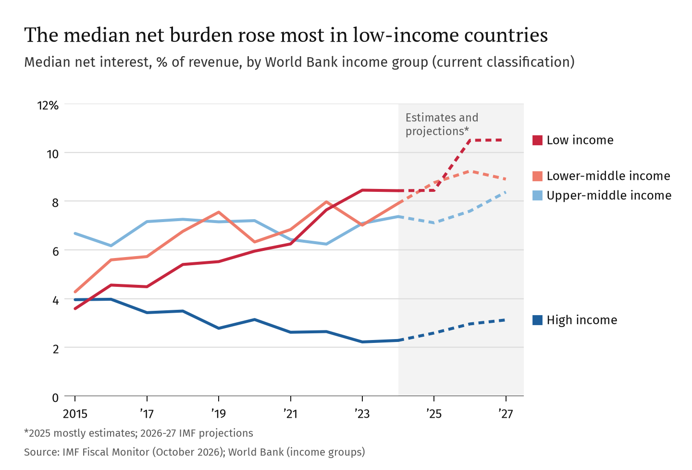
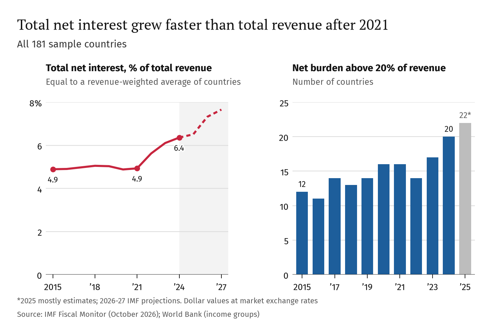
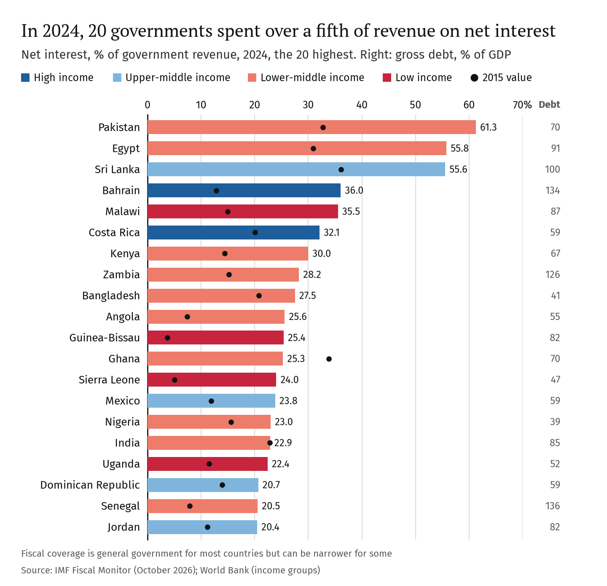
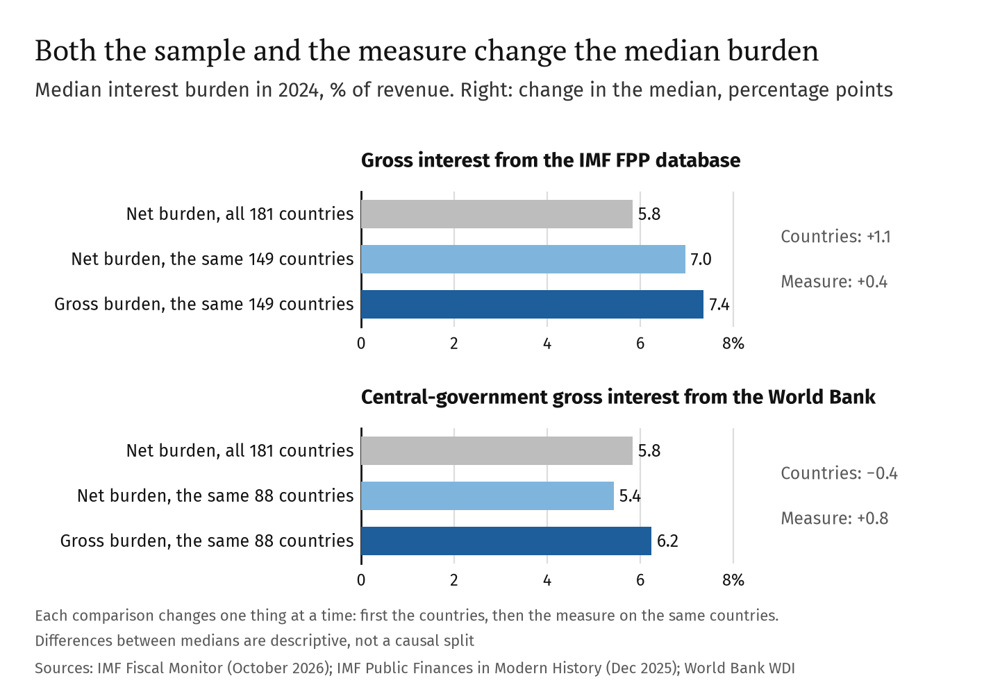
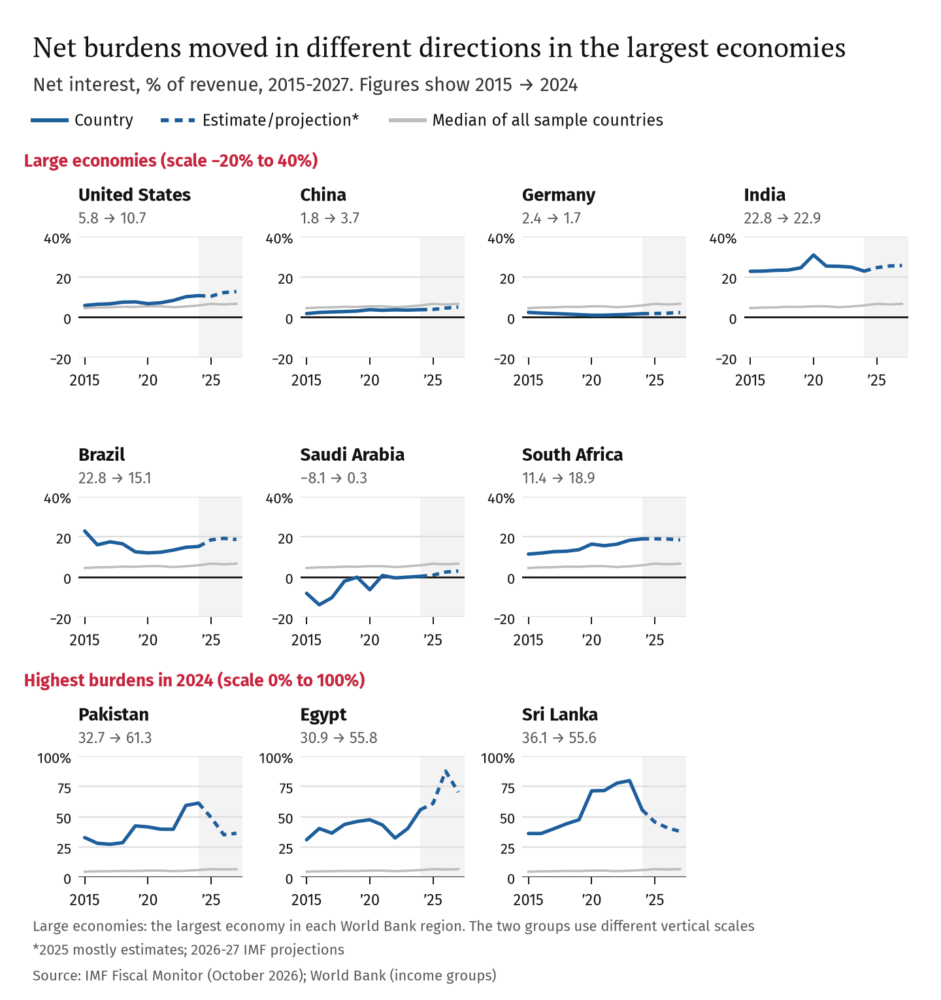
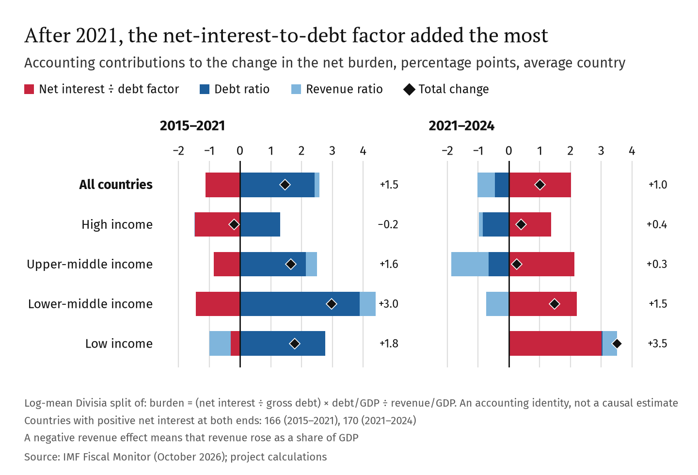
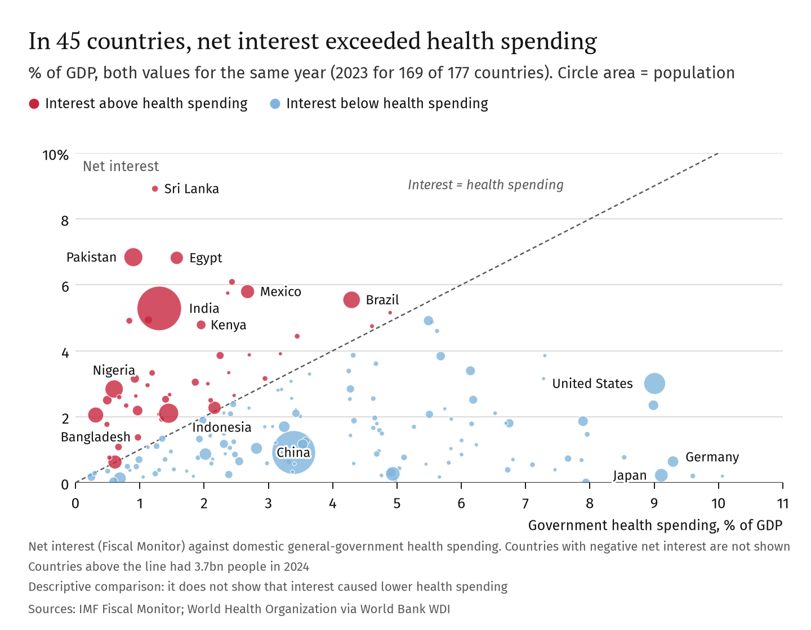
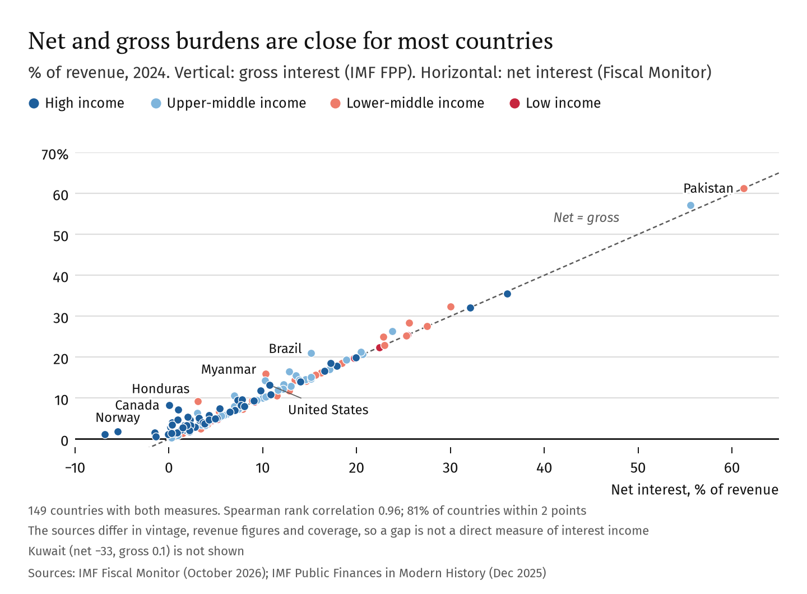

<!-- Generated from templates/economic_analysis.md by src/build_report.py. Edit the template, not this file. -->

# Public debt and interest burdens, 2015–2024

How much government revenue goes to net interest in {{sample/countries}} economies, and what the debt-to-GDP ratio does not show

Sidali Saidj · Revised October 2026 · Data: IMF Fiscal Monitor (October 2026), IMF Public Finances in Modern History (December 2025), World Bank · Prepared with substantial help from Claude, an AI assistant (see Contributions)

## Summary

**Questions.** (1) How did net interest burdens change between 2015 and 2024? (2) How do the debt-to-GDP ratio and the interest-to-revenue ratio describe countries differently? (3) How do the definition of interest and the choice of countries change the picture?

**Measure.** The *net interest burden* is net interest paid by the government divided by government revenue, in percent. Net interest is interest paid minus interest received. Data come from the IMF Fiscal Monitor for {{sample/countries}} economies with complete data for 2015–2024. Two gross-interest series are used as checks.

**Main findings**

1. **Burdens rose in most countries, and most in poorer ones.** The median net burden was {{median_burden/All countries/2015:.1f}}% of revenue in 2015 and {{median_burden/All countries/2024:.1f}}% in 2024; it rose in {{change/countries_up_start_end}} of {{sample/countries}} countries. In low-income countries the median rose from {{median_burden/Low income/2015:.1f}}% to {{median_burden/Low income/2024:.1f}}%. In high-income countries it fell from {{median_burden/High income/2015:.1f}}% to {{median_burden/High income/2024:.1f}}% on the net measure, but it was almost unchanged on a gross measure ({{median_burden_gross/High income/2015:.1f}}% and {{median_burden_gross/High income/2024:.1f}}%). For all countries together, total net interest was {{pooled_burden/All countries/2021:.1f}}% of total revenue in 2021 and {{pooled_burden/All countries/2024:.1f}}% in 2024.
2. **Debt-to-GDP and interest-to-revenue often rank countries differently.** The two measures are clearly related (Spearman rank correlation {{correlation/All countries/spearman:.2f}}), but {{quadrants/different_classification}} of {{sample/countries}} countries ({{quadrants/different_classification_share:.0%}}) are above the median on one measure and below it on the other. Japan has very high debt and a very low net burden; Nigeria has moderate debt and a high burden because its revenue is low.
3. **Definitions and coverage matter.** Net and gross burdens are close for most countries, but not for governments with large interest income, such as Canada. When the net and gross medians are compared, most of the difference for the IMF gross series comes from the smaller set of countries it covers ({{derived/fpp_gap_sample:+.1f}} points), not from the measure itself ({{derived/fpp_gap_measure:+.1f}} points).

**Limits.** These are descriptive results for one data vintage. They do not show causes, and the burden is not a measure of default risk. Fiscal coverage and accounting rules differ between countries.

## 1. The question and the measure

### 1.1 Why compare interest with revenue?

Debt-to-GDP measures the *stock* of debt. It does not show what the debt costs each year or how easily the government can pay that cost. Interest compared with revenue does this: it shows how much of the government's income goes to interest. Interest payments are contractual obligations, so they can limit the room for other spending. They are not completely fixed, however: the interest bill changes when debt is repaid or refinanced, when floating rates change and, for the net measure, when interest income changes. Credit-rating agencies use the interest-to-revenue ratio; for example, Moody's 2019 sovereign methodology uses it as a measure of "debt affordability" (Moody's, 2019).

### 1.2 Net and gross interest

net interest burden (%) = 100 × (primary balance − overall balance) ÷ revenue

The primary balance is the budget balance before net interest, so the difference between the two balances is net interest. All three series come from the same Fiscal Monitor vintage.

*Gross* interest is the interest the government pays before interest income is subtracted. The two measures can be very different for governments with large financial assets. In 2024, Canada's net burden was {{country/CAN/burden_end:.2f}}% of revenue but its gross burden (IMF Public Finances in Modern History, "FPP") was {{country/CAN/gross_end:.1f}}%. For Japan the figures were {{country/JPN/burden_end:.1f}}% and {{country/JPN/gross_end:.1f}}%. A low net burden therefore does not mean a low gross interest bill. In {{regression/countries_excluded_nonpositive}} sample countries net interest was negative in 2024: they received more interest than they paid. This flow alone does not show that their governments hold more assets than debts, so the report does not call them "net creditors".

The report uses the net measure as its main measure because it covers more countries and comes from the same source as the debt and revenue data. Gross results are shown where they change the interpretation.

## 2. Data and sample

**Sources.** Revenue, gross debt and the two budget balances come from the IMF Fiscal Monitor (October 2026); GDP in US dollars from the World Economic Outlook (October 2026). Gross interest and FPP revenue come from the IMF Public Finances in Modern History database (December 2025). The World Bank provides central-government interest payments (`GC.XPN.INTP.RV.ZS`), health and education spending, population, regions and income groups. All data were downloaded on 21 October 2026 and are kept in the repository; a checksum file confirms that they have not changed.

**Sample.** A country is included if it has all four fiscal series in every year from 2015 to 2024. A balanced panel keeps the same countries in every year, but it may leave out countries with weaker statistics.

Table 1. From the World Bank country list to the analysis sample

| Step | Countries | Removed | Removed economies |
|---|---|---|---|
| {{sample/funnel/0/stage}} | {{sample/funnel/0/countries}} | | |
| {{sample/funnel/1/stage}} | {{sample/funnel/1/countries}} | {{sample/funnel/1/dropped}} | Mostly territories and small economies without IMF fiscal data (full list in `outputs/tables/sample_funnel.csv`) |
| {{sample/funnel/2/stage}} | {{sample/funnel/2/countries}} | {{sample/funnel/2/dropped}} | {{sample/funnel/2/dropped_economies}} |
| {{sample/funnel/3/stage}} | {{sample/funnel/3/countries}} | {{sample/funnel/3/dropped}} | {{sample/funnel/3/dropped_economies}} |
| {{sample/funnel/4/stage}} | {{sample/funnel/4/countries}} | {{sample/funnel/4/dropped}} | |

Brunei has complete data but net interest of exactly zero in every year. It is unclear whether interest is not recorded separately or is really zero, so this case is unresolved; adding it back gives a 2024 median of {{sensitivity/Adding Brunei (repeated-zero case)/median_burden_end:.2f}}% instead of {{matched/0/median_burden_end:.2f}}% (Appendix A). Libya and Macao also show repeated zeros, but they already fail the complete-data step.

**Coverage.** The IMF notes that fiscal data for most advanced economies cover general government, while data for many emerging and developing economies cover only central or budgetary central government (IMF Fiscal Monitor methodological appendix). Some countries report on fiscal years: for example Pakistan and Egypt. India's data cover central and state governments. Appendix C lists what could be documented for the countries named in this report.

**Other choices.** Income groups are the World Bank's current classification, used for all years: the results describe the past experience of countries grouped by their current status. Years up to 2024 are treated as past data, but the IMF may still use staff estimates for some of them; 2025 values are mostly estimates and 2026–27 are IMF projections, shown only as context.

## 3. How did net interest burdens change?

Figure 1

The median net burden of all countries rose from {{median_burden/All countries/2015:.1f}}% of revenue in 2015 to {{median_burden/All countries/2021:.1f}}% in 2021 and {{median_burden/All countries/2024:.1f}}% in 2024. The rise was spread over the whole period, not only after 2021. It was largest in low-income countries ({{median_burden/Low income/2015:.1f}}% to {{median_burden/Low income/2024:.1f}}%) and lower-middle-income countries ({{median_burden/Lower middle income/2015:.1f}}% to {{median_burden/Lower middle income/2024:.1f}}%) (Figure 1).

The high-income median fell on the net measure, from {{median_burden/High income/2015:.1f}}% to {{median_burden/High income/2024:.1f}}%. On the gross measure it was almost unchanged ({{median_burden_gross/High income/2015:.1f}}%, {{median_burden_gross/High income/2021:.1f}}% and {{median_burden_gross/High income/2024:.1f}}% in 2015, 2021 and 2024). So part of the fall reflects more interest income, not a lower interest bill. The gross series covers fewer countries ({{matched/2/countries_level}} of {{sample/countries}}), so this comparison is indicative.

Figure 2

Total net interest as a share of total revenue across all countries was stable at {{pooled_burden/All countries/2015:.1f}}% in 2015 and {{pooled_burden/All countries/2021:.1f}}% in 2021, then rose to {{pooled_burden/All countries/2024:.1f}}% in 2024 (Figure 2). This total is calculated after converting both values to US dollars. It equals an average of country burdens weighted by revenue, so large economies such as the United States dominate it. It is not a GDP-weighted average of country burdens, which would be {{gdp_weighted_average_burden_end:.1f}}% in 2024. In dollars, total net interest was about ${{net_interest_usd_trn/2024:.2f}}trn in 2024, against ${{net_interest_usd_trn/2021:.2f}}trn in 2021 (nominal, at market exchange rates). The number of countries with a net burden above 20% of revenue rose from {{high_burden/countries/2015}} in 2015 to {{high_burden/countries/2024}} in 2024. The 20% line is a simple descriptive threshold, not a risk limit.

**What changed: net interest or revenue?** The burden equals net interest/GDP divided by revenue/GDP, so a change in the burden can be split exactly into these two parts (log-mean Divisia method; Appendix A). The split uses countries with positive net interest at the start and end of each period.

Table 2. Contributions to the change in the net burden, percentage points, average country

| Period | Countries | Change in burden | From net interest/GDP | From revenue/GDP |
|---|---|---|---|---|
| 2015–2021 | {{decomposition_two/All countries/2015-2021/countries:.0f}} | {{decomposition_two/All countries/2015-2021/mean_change:+.2f}} | {{decomposition_two/All countries/2015-2021/mean_net_interest_gdp_effect:+.2f}} | {{decomposition_two/All countries/2015-2021/mean_revenue_effect:+.2f}} |
| 2021–2024 | {{decomposition_two/All countries/2021-2024/countries:.0f}} | {{decomposition_two/All countries/2021-2024/mean_change:+.2f}} | {{decomposition_two/All countries/2021-2024/mean_net_interest_gdp_effect:+.2f}} | {{decomposition_two/All countries/2021-2024/mean_revenue_effect:+.2f}} |

A negative revenue contribution means that revenue rose as a share of GDP. On the {{decomposition_common/two_factor/0/countries}} countries present in both periods the pattern is the same (Appendix A). Medians are smaller than means: see <code>outputs/tables/decomposition_two_factor_by_group.csv</code>.

In both periods the average burden rose because net interest grew faster than GDP. After 2021, higher revenue offset part of this ({{decomposition_two/All countries/2021-2024/mean_revenue_effect:+.1f}} points). Appendix A splits net interest/GDP further into a *net-interest-to-debt factor* (net interest divided by gross debt) and the debt ratio. Between 2021 and 2024 this factor made the largest positive contribution on average ({{decomposition_three/All countries/2021-2024/mean_nid_effect:+.1f}} points), while falling debt ratios reduced the burden ({{decomposition_three/All countries/2021-2024/mean_debt_effect:+.1f}} points). The factor was the largest positive contribution in {{dominance/2021-2024/largest_positive}} of {{dominance/2021-2024/countries}} countries. This pattern is consistent with the rise in interest rates after 2021. However, the factor is not a borrowing rate: it also changes with interest income on assets, the timing of debt flows and valuation changes. The split is accounting, so it cannot measure how much higher policy rates caused.

## 4. How do debt-to-GDP and interest-to-revenue describe countries differently?

Figure 3

In 2024, {{high_burden/countries/2024}} countries had a net burden above 20% of revenue (Figure 3). Pakistan ({{country/PAK/burden_end:.1f}}%), Egypt ({{country/EGY/burden_end:.1f}}%) and Sri Lanka ({{country/LKA/burden_end:.1f}}%) were above 50%. Of the top 20, {{top20_low_and_lower_middle}} are low- or lower-middle-income countries. Their debt ratios vary a lot: from {{top20_debt/min:.0f}}% of GDP ({{top20_debt/min_country}}) to {{top20_debt/max:.0f}}% ({{top20_debt/max_country}}).

Figure 4

Countries with more debt tend to have higher burdens: the Spearman rank correlation is {{correlation/All countries/spearman:.2f}} (95% bootstrap interval {{correlation/All countries/ci_low:.2f}} to {{correlation/All countries/ci_high:.2f}}). The relationship is far from exact (Figure 4). Of the {{sample/countries}} countries, {{quadrants/counts/Above-median debt, below-median burden}} have above-median debt but a below-median burden; {{quadrants/debt_high_burden_low_hic_share:.0%}} of them are high-income. Another {{quadrants/counts/Below-median debt, above-median burden}} have below-median debt but an above-median burden; {{quadrants/debt_low_burden_high_lic_lmic_share:.0%}} of them are low- or lower-middle-income. Japan's debt is {{country/JPN/debt_end:.0f}}% of GDP and its net burden {{country/JPN/burden_end:.1f}}% (gross {{country/JPN/gross_end:.1f}}%). Nigeria's debt is {{country/NGA/debt_end:.0f}}% of GDP, but its burden is {{country/NGA/burden_end:.0f}}% because revenue is only {{country/NGA/revenue_end:.0f}}% of GDP. Bangladesh is similar (debt {{country/BGD/debt_end:.0f}}%, revenue {{country/BGD/revenue_end:.1f}}%, burden {{country/BGD/burden_end:.0f}}%).

**Regressions.** Table 3 describes the 2024 cross-section with ordinary least squares on logarithms. Logarithms need positive values, so the models use the {{regression/countries_positive}} countries with positive net interest; {{regression/countries_excluded_nonpositive}} countries are left out.

Table 3. Cross-country regressions, 2024 (95% confidence intervals in brackets)

| | (1) Debt only | (2) Debt and revenue | (3) Adding income group |
|---|---|---|---|
| Dependent variable | log net burden | log net burden | log net burden |
| log debt/GDP | {{regression/debt_only/coef:.2f}} [{{regression/debt_only/ci_low:.2f}}, {{regression/debt_only/ci_high:.2f}}] | {{regression/debt_with_revenue/coef:.2f}} [{{regression/debt_with_revenue/ci_low:.2f}}, {{regression/debt_with_revenue/ci_high:.2f}}] | {{regression/debt_full/coef:.2f}} [{{regression/debt_full/ci_low:.2f}}, {{regression/debt_full/ci_high:.2f}}] |
| log revenue/GDP | | {{regression/revenue/coef:.2f}} [{{regression/revenue/ci_low:.2f}}, {{regression/revenue/ci_high:.2f}}] | {{regression/revenue_full/coef:.2f}} [{{regression/revenue_full/ci_low:.2f}}, {{regression/revenue_full/ci_high:.2f}}] |
| R² | {{regression/debt_only/r_squared:.2f}} | {{regression/debt_with_revenue/r_squared:.2f}} | {{regression/debt_full/r_squared:.2f}} |
| R² range when one country is left out | {{influence/debt_only_r2_without_min:.2f}}–{{influence/debt_only_r2_without_max:.2f}} | {{influence/with_revenue_r2_without_min:.2f}}–{{influence/with_revenue_r2_without_max:.2f}} | |
| Countries | {{regression/debt_only/countries}} | {{regression/debt_with_revenue/countries}} | {{regression/debt_full/countries}} |

Heteroskedasticity-robust (HC3) standard errors. R² is the in-sample fit for log burdens among countries with positive net interest in 2024. It is not the share of variation in burdens explained for all {{sample/countries}} countries, and it is not a forecast accuracy. Full results: <a href="../outputs/tables/regressions.csv">regressions.csv</a>, <a href="../outputs/tables/regression_influence.csv">regression_influence.csv</a>.

In model 1, debt explains {{regression/debt_only/r_squared:.0%}} of the variation in log burdens. This number depends on a few countries. {{influence/debt_only_top/0/name}} and {{influence/debt_only_top/1/name}} have the largest influence (Cook's distance {{influence/debt_only_top/0/cooks_distance:.2f}} and {{influence/debt_only_top/1/cooks_distance:.2f}}). Canada's net burden is close to zero ({{country/CAN/burden_end:.3f}}% of revenue), so its logarithm is extreme. Without Canada, R² is {{influence/debt_only_r2_without_canada:.2f}}; leaving out any single country gives values between {{influence/debt_only_r2_without_min:.2f}} and {{influence/debt_only_r2_without_max:.2f}}. Canada stays in the main results: it is a valid observation, and removing it only to improve the fit would not be justified. A model in levels that keeps all {{levels_model/countries}} countries, including those with negative net interest, gives R² = {{levels_model/r_squared:.2f}}, a debt coefficient of {{levels_model/debt_coef:.3f}} ({{levels_model/debt_ci_low:.3f}} to {{levels_model/debt_ci_high:.3f}}) and a revenue coefficient of {{levels_model/revenue_coef:.2f}} ({{levels_model/revenue_ci_low:.2f}} to {{levels_model/revenue_ci_high:.2f}}).

Adding revenue raises R² to {{regression/debt_with_revenue/r_squared:.2f}}. This is partly built into the measure: revenue is the denominator of the burden, so a negative coefficient on revenue is expected by construction. The result shows that low revenue and high burdens go together at similar debt levels. It does not show which policy would lower burdens most.

A fourth model (Appendix A) relates the net-interest-to-debt factor to debt and income group. Its debt coefficient is {{regression/nid_on_debt/coef:.2f}} (95% interval {{regression/nid_on_debt/ci_low:.2f}} to {{regression/nid_on_debt/ci_high:.2f}}): the model cannot estimate this relationship precisely. At similar debt, the factor is about {{derived/nid_multiple_upper_middle:.1f}} times higher in upper-middle-income countries and {{derived/nid_multiple_lower_middle:.1f}} times higher in lower-middle-income countries than in high-income countries. For low-income countries the estimate ({{derived/nid_multiple_low_income:.1f}} times) is imprecise.

## 5. How do definitions and coverage change the picture?

Figure 5

The gross FPP median in 2024 ({{matched/2/median_burden_end:.1f}}%) is {{derived/fpp_gap_total:.1f}} points higher than the net median for all countries ({{matched/0/median_burden_end:.1f}}%). Figure 5 changes one thing at a time. First, the net median on the same {{matched/1/countries_level}} countries that FPP covers is {{matched/1/median_burden_end:.1f}}% ({{derived/fpp_gap_sample:+.1f}} points). Second, the gross measure on those countries is {{matched/2/median_burden_end:.1f}}% ({{derived/fpp_gap_measure:+.1f}} points). So about {{derived/fpp_gap_sample_share:.0%}} of the difference comes from country coverage. The World Bank central-government series shows a different pattern: its {{matched/4/countries_level}} countries have a *lower* net median ({{matched/4/median_burden_end:.1f}}%, {{derived/wb_gap_sample:+.1f}} points), and its measure is higher ({{matched/5/median_burden_end:.1f}}%, {{derived/wb_gap_measure:+.1f}} points); central-government coverage is one possible reason. These are descriptive comparisons of medians, not a causal split.

Across the {{measure_agreement/gross_fpp/countries}} countries with both values, the net and gross burdens have a rank correlation of {{measure_agreement/gross_fpp/spearman:.2f}}, and {{measure_agreement/gross_fpp/within_2_points:.0%}} differ by 2 points or less (Appendix B, Figure A3). Larger differences can come from interest income, but also from different revenue figures, coverage, accounting and data vintages in the two IMF databases, so they are not a direct measure of interest income.

Figure 6

Among the largest economies (Figure 6), the net burden rose in the United States ({{country/USA/burden_start:.1f}}% to {{country/USA/burden_end:.1f}}%), China ({{country/CHN/burden_start:.1f}}% to {{country/CHN/burden_end:.1f}}%) and South Africa ({{country/ZAF/burden_start:.1f}}% to {{country/ZAF/burden_end:.1f}}%). It fell in Germany ({{country/DEU/burden_start:.1f}}% to {{country/DEU/burden_end:.1f}}%) and Brazil ({{country/BRA/burden_start:.1f}}% to {{country/BRA/burden_end:.1f}}%; Brazil's gross FPP burden was {{country/BRA/gross_end:.1f}}% in 2024). India's stayed close to {{country/IND/burden_end:.0f}}%. Saudi Arabia moved from negative net interest to a small positive burden. Among the three highest burdens, Egypt's is projected by the IMF to reach {{country/EGY/burden_max_forecast:.0f}}% in {{country/EGY/burden_max_forecast_year}}. Sri Lanka's peaked at {{country/LKA/burden_peak:.0f}}% in {{country/LKA/burden_peak_year}} and was {{country/LKA/burden_end:.0f}}% in 2024.

**Falling burdens after a default.** Measured burdens fell sharply in Lebanon (2020), Ghana (2023) and Sri Lanka (2024), around default or debt restructuring. The data alone do not show whether this reflects interest that was not paid, the accounting treatment of the restructured debt or other changes; this was not checked in country documents. A lower measured burden does not by itself mean that debt became sustainable.

## 6. Interest and health spending

Net interest was larger than government health spending in {{social_spending/countries_interest_gt_health}} of the {{social_spending/countries_health}} countries with data (Appendix B, Figure A2). Each comparison uses the same year for both values: {{social_spending/health_years/2023}} countries use 2023, {{social_spending/health_years/2024}} use 2024 and {{social_spending/health_years/2021}} uses 2021. These countries had {{social_spending/population_interest_gt_health_bn:.1f}}bn people in {{social_spending/population_year}}. For example, in {{country/IND/health_year}} India's net interest was {{country/IND/interest_gdp_health_year:.2f}}% of GDP and its government health spending {{country/IND/health_gdp:.2f}}%. For education, net interest was larger in {{social_spending/countries_interest_gt_education}} of {{social_spending/countries_education}} countries ({{social_spending/population_interest_gt_education_bn:.1f}}bn people); education data are older for many countries (2019–2024). UNCTAD (2024) reported a similar order of magnitude with different data: 3.3 billion people in countries that spend more on interest than on education or health care.

This comparison is descriptive. It does not show that interest payments caused lower health spending. Low revenue could explain both a high interest burden and low health spending; this was not tested.

## 7. Limitations

- **Descriptive, not causal.** The results describe patterns. They do not identify the effect of debt, revenue or interest rates.
- **One data vintage.** IMF data are revised twice a year. The results apply to the October 2026 Fiscal Monitor.
- **Net interest.** The net measure is lower than the gross interest bill when governments earn interest. Gross data cover fewer countries and come from a different database.
- **Coverage and accounting.** Government coverage, fiscal years and accounting rules differ by country, and some values are IMF estimates.
- **Not a default-risk measure.** The ratio says nothing about debt maturity, currency, creditors or principal repayments.
- **Small groups.** Only {{sample/by_income/Low income}} low-income countries are in the sample, so their estimates are less precise.

## 8. What the results suggest

These points follow from the measures and patterns above. None is an estimated effect of a policy.

1. **Look at both indicators.** Debt-to-GDP and interest-to-revenue answer different questions. Using only debt-to-GDP would flag Japan and miss Nigeria and Bangladesh.
2. **Low revenue goes with high burdens.** At similar debt levels, countries with low revenue tend to have higher burdens. As an illustration, if the interest bill stays the same, raising revenue from 12% to 15% of GDP lowers the burden by 20%; a 20% lower interest bill would have the same effect. The study does not compare how feasible or costly these options are. The right response depends on each country's tax capacity, spending needs, growth and borrowing terms.
3. **Debt composition matters.** Debt in foreign currency can make interest costs rise when the exchange rate falls (Eichengreen and Hausmann, 1999). This study does not measure debt composition or maturity.
4. **Read falling burdens with care.** A fall after a default or restructuring is not, by itself, evidence of sustainable debt.

## 9. Conclusion

Net interest took a larger share of revenue in 2024 than in 2015 in most of the {{sample/countries}} countries studied. The median rose from {{median_burden/All countries/2015:.1f}}% to {{median_burden/All countries/2024:.1f}}%, with the largest increases in poorer countries. Debt-to-GDP and interest-to-revenue are related, but they often rank countries differently, mainly because revenue and the net-interest-to-debt factor differ widely between countries. How interest is defined and which countries are covered change the size of the results, so both should be stated with every headline number.

The first version of this project stated four hypotheses. They were written by Claude after the data coverage and the 2024 ranking had been checked, but before the correlations, regressions and decomposition were run. The Git history does not record this order, so a reader cannot verify it.

| Hypothesis | Verdict in this revision |
|---|---|
| H1: the typical burden was higher in 2024 than in 2015, with most of the rise after 2021 | Partly supported: higher, but the median rose over the whole period |
| H2: debt-to-GDP is positively but weakly related to the burden | Partly supported: moderately related; debt alone describes the burden incompletely, and the size of R² depends on a few countries |
| H3: at similar debt, poorer countries have higher burdens because of higher rates and lower revenue | Supported for revenue (partly by construction of the measure); the net-interest-to-debt factor is higher in middle-income countries; the low-income estimate is imprecise |
| H4: after 2021 the rise came mainly from higher implicit rates | The accounting pattern is consistent with this, but the factor is not a borrowing rate and the effect of interest rates was not estimated |

## Contributions

Sidali Saidj chose the research question, set the project requirements and asked for this revision after an external audit. Claude, an AI assistant made by Anthropic, did most of the data collection, SQL and Python code, charts and writing, in the first version and in this revision. The repository does not record which results the author has checked personally.

## Appendix A. Methods and sensitivity checks

**Three-factor accounting split.** The net burden can also be written as

burden = (net interest ÷ gross debt) × (debt ÷ GDP) ÷ (revenue ÷ GDP)

The first term, the *net-interest-to-debt factor*, uses net interest and end-year gross debt. It is an accounting ratio, not the interest rate paid on borrowing: it falls when interest income rises, and it is affected by the timing of debt flows and by valuation changes. The log-mean Divisia index (Ang, 2004) splits each country's change into contributions that add up exactly to the change. Countries need positive net interest at both ends of a period. Results by income group are in Figure A1 and in <code>outputs/tables/decomposition_three_factor_by_group.csv</code>.

Table A1. Three-factor split, average country, percentage points

| Sample | Period | Countries | Change | Net interest ÷ debt | Debt ratio | Revenue ratio |
|---|---|---|---|---|---|---|
| Each period | 2015–2021 | {{decomposition_three/All countries/2015-2021/countries:.0f}} | {{decomposition_three/All countries/2015-2021/mean_change:+.2f}} | {{decomposition_three/All countries/2015-2021/mean_nid_effect:+.2f}} | {{decomposition_three/All countries/2015-2021/mean_debt_effect:+.2f}} | {{decomposition_three/All countries/2015-2021/mean_revenue_effect:+.2f}} |
| Each period | 2021–2024 | {{decomposition_three/All countries/2021-2024/countries:.0f}} | {{decomposition_three/All countries/2021-2024/mean_change:+.2f}} | {{decomposition_three/All countries/2021-2024/mean_nid_effect:+.2f}} | {{decomposition_three/All countries/2021-2024/mean_debt_effect:+.2f}} | {{decomposition_three/All countries/2021-2024/mean_revenue_effect:+.2f}} |
| Each period | 2015–2024 | {{decomposition_three/All countries/2015-2024/countries:.0f}} | {{decomposition_three/All countries/2015-2024/mean_change:+.2f}} | {{decomposition_three/All countries/2015-2024/mean_nid_effect:+.2f}} | {{decomposition_three/All countries/2015-2024/mean_debt_effect:+.2f}} | {{decomposition_three/All countries/2015-2024/mean_revenue_effect:+.2f}} |
| Common countries | 2015–2021 | {{decomposition_common/three_factor/0/countries}} | {{decomposition_common/three_factor/0/mean_change:+.2f}} | {{decomposition_common/three_factor/0/mean_nid_effect:+.2f}} | {{decomposition_common/three_factor/0/mean_debt_effect:+.2f}} | {{decomposition_common/three_factor/0/mean_revenue_effect:+.2f}} |
| Common countries | 2021–2024 | {{decomposition_common/three_factor/1/countries}} | {{decomposition_common/three_factor/1/mean_change:+.2f}} | {{decomposition_common/three_factor/1/mean_nid_effect:+.2f}} | {{decomposition_common/three_factor/1/mean_debt_effect:+.2f}} | {{decomposition_common/three_factor/1/mean_revenue_effect:+.2f}} |

The net-interest-to-debt and debt contributions add up to the net interest/GDP contribution in Table 2. "Largest positive contribution" means that the factor's contribution is above zero and larger than the other two. For 2021–2024 this is true in {{dominance/2021-2024/largest_positive}} of {{dominance/2021-2024/countries}} countries. In {{dominance/2021-2024/largest_signed_but_not_positive}} more, all three contributions are negative and the factor's is the least negative; these are not counted. The factor has the largest contribution in absolute size in {{dominance/2021-2024/largest_absolute}} countries.

**Regressions.** Models 1–3 are in Table 3. Model 4 uses the log of the net-interest-to-debt factor as the dependent variable, with log debt and income-group dummies (high income is the base). All use HC3 standard errors. Influence checks use Cook's distance and leverage from models 1 and 2 without robust errors, and refit each model leaving out one country at a time.

Table A2. Sensitivity of headline statistics, 2024

| Specification | Countries | Median burden, % | Median change since 2015, points | Share above 20%, % | Debt–burden rank correlation |
|---|---|---|---|---|---|
| Baseline: net burden, all sample countries | {{matched/0/countries_level}} | {{matched/0/median_burden_end:.1f}} | {{matched/0/median_change_since_start:.1f}} | {{matched/0/share_above_threshold:.0f}} | {{matched/0/spearman_debt_burden:.2f}} |
| Net burden, countries covered by FPP | {{matched/1/countries_level}} | {{matched/1/median_burden_end:.1f}} | {{matched/1/median_change_since_start:.1f}} | {{matched/1/share_above_threshold:.0f}} | {{matched/1/spearman_debt_burden:.2f}} |
| Gross burden (FPP), same countries | {{matched/2/countries_level}} | {{matched/2/median_burden_end:.1f}} | {{matched/2/median_change_since_start:.1f}} | {{matched/2/share_above_threshold:.0f}} | {{matched/2/spearman_debt_burden:.2f}} |
| Net burden, countries covered by the World Bank series | {{matched/4/countries_level}} | {{matched/4/median_burden_end:.1f}} | {{matched/4/median_change_since_start:.1f}} | {{matched/4/share_above_threshold:.0f}} | {{matched/4/spearman_debt_burden:.2f}} |
| Central-government gross burden (World Bank), same countries | {{matched/5/countries_level}} | {{matched/5/median_burden_end:.1f}} | {{matched/5/median_change_since_start:.1f}} | {{matched/5/share_above_threshold:.0f}} | {{matched/5/spearman_debt_burden:.2f}} |
| Excluding countries with negative net interest | {{sensitivity/Excluding countries with negative net interest/countries_level}} | {{sensitivity/Excluding countries with negative net interest/median_burden_end:.1f}} | {{sensitivity/Excluding countries with negative net interest/median_change_since_start:.1f}} | {{sensitivity/Excluding countries with negative net interest/share_above_threshold:.0f}} | {{sensitivity/Excluding countries with negative net interest/spearman_debt_burden:.2f}} |
| Excluding small states (population below 1.5 million) | {{sensitivity/Excluding small states/countries_level}} | {{sensitivity/Excluding small states/median_burden_end:.1f}} | {{sensitivity/Excluding small states/median_change_since_start:.1f}} | {{sensitivity/Excluding small states/share_above_threshold:.0f}} | {{sensitivity/Excluding small states/spearman_debt_burden:.2f}} |
| End year 2025 (mostly estimates) | {{sensitivity/End year 2025 (mostly estimates)/countries_level}} | {{sensitivity/End year 2025 (mostly estimates)/median_burden_end:.1f}} | {{sensitivity/End year 2025 (mostly estimates)/median_change_since_start:.1f}} | {{sensitivity/End year 2025 (mostly estimates)/share_above_threshold:.0f}} | {{sensitivity/End year 2025 (mostly estimates)/spearman_debt_burden:.2f}} |
| Adding Brunei (repeated-zero case) | {{sensitivity/Adding Brunei (repeated-zero case)/countries_level}} | {{sensitivity/Adding Brunei (repeated-zero case)/median_burden_end:.1f}} | {{sensitivity/Adding Brunei (repeated-zero case)/median_change_since_start:.1f}} | {{sensitivity/Adding Brunei (repeated-zero case)/share_above_threshold:.0f}} | {{sensitivity/Adding Brunei (repeated-zero case)/spearman_debt_burden:.2f}} |

Median change: the median of country changes since 2015, not the change in the median; countries with values in both years ({{matched/2/countries_change}} for FPP, {{matched/5/countries_change}} for World Bank). Trimming the top and bottom 5% of 2024 burdens gives a rank correlation of {{spearman_trimmed:.2f}}.

## Appendix B. Additional figures

Figure A1

Figure A2

Figure A3

## Appendix C. Coverage notes for highlighted countries

The table lists only what could be documented in this revision. The IMF Fiscal Monitor methodological appendix has a full table by country, but it could not be downloaded for this revision (the IMF website returned "Access Denied"). The other cells are unresolved and should be checked in that appendix before any country comparison is used.

| Country | What is documented | Source |
|---|---|---|
| Advanced economies (general) | Fiscal data mostly cover general government | IMF Fiscal Monitor, Methodological and Statistical Appendix |
| Emerging and developing economies (general) | Data often cover only central or budgetary central government | IMF Fiscal Monitor, Methodological and Statistical Appendix |
| Pakistan | Data on a fiscal-year basis | IMF Fiscal Monitor, October 2024, appendix notes |
| Egypt | Data on a fiscal-year basis | IMF Fiscal Monitor, October 2024, appendix notes |
| India | Data cover central and state governments | IMF Fiscal Monitor, April 2026, appendix notes |
| United States, China, Germany, Brazil, South Africa, Saudi Arabia, Sri Lanka, Japan, Canada, Nigeria, Bangladesh, Lebanon, Ghana | Not documented in this revision (unresolved) | — |

## References

Ang, B. W. (2004). Decomposition analysis for policymaking in energy: which is the preferred method? *Energy Policy*, 32(9), 1131–1139. <https://doi.org/10.1016/S0301-4215(03)00076-4>

Blanchard, O. (2019). Public debt and low interest rates. *American Economic Review*, 109(4), 1197–1229. <https://doi.org/10.1257/aer.109.4.1197>

Eichengreen, B., and Hausmann, R. (1999). Exchange rates and financial fragility. NBER Working Paper 7418. <https://www.nber.org/papers/w7418>

Escolano, J. (2010). *A Practical Guide to Public Debt Dynamics, Fiscal Sustainability, and Cyclical Adjustment of Budgetary Aggregates*. IMF Technical Notes and Manuals 10/02. <https://www.imf.org/external/pubs/ft/tnm/2010/tnm1002.pdf>

Furman, J., and Summers, L. (2020). A reconsideration of fiscal policy in the era of low interest rates. Discussion draft, Brookings Institution and Peterson Institute for International Economics. <https://www.brookings.edu/wp-content/uploads/2020/11/furman-summers-fiscal-reconsideration-discussion-draft.pdf>

IMF (2024). *Fiscal Monitor, October 2024: Putting a Lid on Public Debt*. <https://www.imf.org/en/Publications/FM/Issues/2024/10/23/fiscal-monitor-october-2024>

IMF (2024, 2026). *Fiscal Monitor, Methodological and Statistical Appendix* (October 2024; April 2026). <https://www.imf.org/-/media/files/publications/fiscal-monitor/2024/october/english/msa.pdf>

IMF (2025, 2026). *Fiscal Monitor* and *World Economic Outlook* databases (October 2026) and *Public Finances in Modern History* database (December 2025), via the IMF DataMapper API. <https://www.imf.org/external/datamapper/>

Kose, M. A., Nagle, P., Ohnsorge, F., and Sugawara, N. (2021). *Global Waves of Debt: Causes and Consequences*. World Bank. <http://hdl.handle.net/10986/32809>

Mauro, P., Romeu, R., Binder, A., and Zaman, A. (2015). A modern history of fiscal prudence and profligacy. *Journal of Monetary Economics*, 76, 55–70. Working-paper version: IMF WP/13/5. <https://www.imf.org/en/publications/wp/issues/2016/12/31/a-modern-history-of-fiscal-prudence-and-profligacy-40222>

Moody's Investors Service (2019). *Sovereign Ratings Methodology*, November 2019 (replaced in November 2022 by a version with the same factors). <https://ratings.moodys.com/api/rmc-documents/63168>

Reinhart, C. M., Rogoff, K. S., and Savastano, M. A. (2003). Debt intolerance. *Brookings Papers on Economic Activity*, 2003(1), 1–74. <https://www.brookings.edu/articles/debt-intolerance/>

UNCTAD (2024). Global public debt hits record $97 trillion in 2023, UN urges action (news release for *A World of Debt 2024*). <https://unctad.org/news/global-public-debt-hits-record-97-trillion-2023-un-urges-action>

World Bank (2026). *World Development Indicators*, via the World Bank API. <https://data.worldbank.org/>
